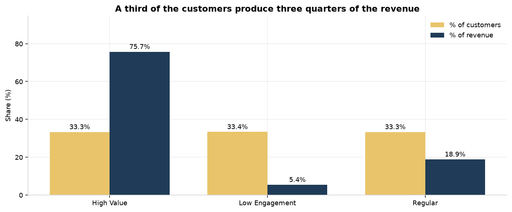

# Shopify purchasing behaviour analysis

An end-to-end e-commerce analytics case study: revenue performance, average
order value by customer segment, purchase frequency, repeat-purchase rate and
the purchasing patterns behind them.

Python · SQLite · SQL · Streamlit + Plotly · 33 named SQL queries ·
23 automated data-quality checks · 46 automated tests · 10 figures

> ## ⚠️ The data is synthetic
>
> Shopify publishes no public transaction dataset, and the workspace this
> project was built in contained no e-commerce data. Rather than quietly
> substituting an unrelated public dataset, this project **generates its own
> store** (`src/generate_data.py`, fixed seed `20261025`) and labels every
> finding as a demonstration.
>
> **No number in this repository describes a real Shopify merchant, customer
> or order.** What is real is the engineering: the revenue definition, the
> cleaning rules, the reconciliation, the segmentation method, the tests. All
> of it transfers unchanged to a real export.

---

## Quick start

```bash
# From the project root, with the workspace virtualenv:
python src/run_all.py            # generate -> build -> query -> report -> figures -> tests
streamlit run dashboard/app.py   # then open http://localhost:8501
```

`run_all.py` rebuilds everything from scratch in about three minutes and
finishes by running the test suite. Individual steps can be run on their own:

| Step | Command | Output |
|---|---|---|
| 1 | `python src/generate_data.py` | `data/raw/*.csv` |
| 2 | `python src/build_db.py` | `shopify_analysis.db` |
| 3 | `python src/run_queries.py` | `reports/sql_results.md`, `reports/key_metrics.json` |
| 4 | `python src/make_quality_report.py` | `reports/data_quality.md` |
| 5 | `python src/make_figures.py` | `reports/figures/*.png` |
| 6 | `pytest -q` | test results |
| — | `streamlit run dashboard/app.py` | the dashboard |

### Requirements

Python 3.10+ (developed on 3.12.10). SQLite ships with Python, so there is no
database server to install.

```bash
pip install -r requirements.txt
```

---

## The five KPIs

All from `kpi_summary` in `sql/04_analysis_queries.sql`, over the full
observation window (2024-01-01 → 2025-12-31):

| KPI | Value |
|---|---:|
| **Total net revenue** | **$1,681,819.35** |
| **Average order value** | **$332.31** |
| **Repeat purchase rate** | **40.94%** (822 of 2,008 customers) |
| **Product performance** | *Essential Two Person Tent* — $98,870.65 (5.88% of revenue) |
| **Customer purchasing behaviour** | 2.52 orders per customer · 21,602 units sold |

Supporting: 5,061 eligible orders · 2,008 unique customers · $837.56 revenue
per customer · 2.56% effective discount rate.

**Revenue definition.** `quantity × unit_price × (1 − discount_pct)` per line,
minus the order's refund allocated pro-rata by net line value. **Shipping and
tax are not revenue.** The full bridge (gross $1,759,900.43 → discounts
−$45,116.84 → refunds −$32,964.24 → net $1,681,819.35) is published in the
`revenue_bridge` query and closes exactly.

---

## Key findings

1. **A third of the customers produce three quarters of the revenue.** The
   High Value segment is 669 of 2,008 customers (33.32%) and 75.73% of net
   revenue. The Low Engagement segment is 33.37% of customers and 5.41% of
   revenue — a 14× spread in revenue per customer.

2. **Value comes from frequency, not from bigger baskets.** The *Regular*
   segment has the **highest AOV** of the three ($368.72 vs High Value's
   $360.72) but only 1.29 orders each. High Value customers win on frequency
   (5.28 orders) and lifetime value ($1,903.91 vs $473.99). Optimising for
   "highest AOV segment" would target the group that generates 18.85% of
   revenue.

3. **Repeat buyers are worth 5.6× one-time buyers** — $1,626.44 against
   $290.80 — and **62.97% of all revenue** comes from repeat orders.

4. **Growth has been volume, and volume is now the only lever.** Revenue grew
   157.4% between 2024 and 2025 while **AOV fell 6.4%** ($348.76 → $326.33).
   The growth came from 500 → 1,986 buying customers, not from larger baskets.

5. **A quarter of the units earn a seventh of the revenue.** Beauty and Kids &
   Baby are 25.55% of units but 13.48% of revenue ($39.00 and $43.16 per unit
   against $101–$109 for Footwear, Electronics and Sports & Outdoors).


Full evidence and three actionable recommendations:
**[`reports/business_analysis.md`](reports/business_analysis.md)**.

---

## The dashboard

```bash
streamlit run dashboard/app.py
```

Five KPI cards across the top, then five tabs.

| Tab | Contents |
|---|---|
| **Revenue** | Monthly revenue and order volume, the gross→net revenue waterfall, revenue by category with a drill-down table |
| **Products** | Top 10 by revenue, top 10 by units, and the high-volume / low-revenue table |
| **Customers** | AOV by segment, segment distribution (customers vs revenue), repeat vs one-time customers, orders-per-customer distribution, the segment scorecard and the time-between-purchases metrics |
| **Data quality** | All 23 validation checks, the row-count trail and the reconciliation proof |
| **Methodology** | The definitions behind every number, in the app |

**Filters:** order date range, product category and customer segment. The date
filter applies at order level, the category filter at line level and the
segment filter at customer level. Segments are computed once on the full
population and are never re-computed when a filter changes.

Every chart is drawn from the named queries in `sql/04_analysis_queries.sql`
— the same SQL the report renders and the tests assert against — so the
dashboard cannot drift from the published analysis. The test suite compares
them directly (`TestDashboardParity`).



---

## Repository map

```
shopify-purchasing-behavior-analysis/
├── README.md                     ← you are here
├── requirements.txt
├── shopify_analysis.db           ← built by src/build_db.py
│
├── data/
│   ├── README.md                 ← how the synthetic data is generated
│   ├── dictionary.md             ← column-level dictionary
│   └── raw/                      ← committed, deterministic CSVs
│       ├── customers.csv  products.csv
│       ├── orders.csv     order_items.csv
│       └── defects.csv           ← audit trail of injected defects
│
├── sql/
│   ├── 01_schema.sql             ← raw landing tables
│   ├── 02_staging.sql            ← cleaning rules R0–R4
│   ├── 03_marts.sql              ← facts, customer dimension, segmentation
│   ├── 04_analysis_queries.sql   ← 22 analysis queries
│   └── 05_data_quality.sql       ← 11 validation queries
│
├── src/
│   ├── config.py                 ← paths, seed, revenue rules (single source of truth)
│   ├── generate_data.py          ← the synthetic generator
│   ├── build_db.py               ← CSV → SQLite, with build-time assertions
│   ├── analytics.py              ← shared query layer for report + dashboard + tests
│   ├── run_queries.py            ← renders reports/sql_results.md
│   ├── make_quality_report.py    ← renders reports/data_quality.md
│   ├── make_figures.py           ← renders reports/figures/*.png
│   └── run_all.py                ← the whole pipeline in one command
│
├── dashboard/
│   └── app.py                    ← Streamlit + Plotly
│
├── reports/
│   ├── business_analysis.md      ← the business report
│   ├── data_quality.md           ← generated validation report
│   ├── sql_results.md            ← every query, every table
│   ├── key_metrics.json          ← headline KPIs as JSON
│   └── figures/                  ← 10 figures
│
├── docs/
│   ├── methodology.md            ← definitions, formulas, rules
│   └── implementation_plan.md    ← the plan this project was built from
│
└── tests/
    ├── test_analysis.py          ← 46 tests
    └── smoke_dashboard.py        ← boots the real Streamlit server
```

---

## Method in one page

**Revenue** is `quantity × unit_price × (1 − discount_pct)` per line, less the
order's refund allocated pro-rata by net line value. Shipping and tax are
excluded and reported separately. All money is computed in **integer cents**,
because Python's `round()` and SQLite's `ROUND()` disagree on exact ties and
that disagreement produced one-cent reconciliation gaps in an earlier build.

**Eligible orders** are `completed`, inside the observation window, resolvable
to a known customer, and containing at least one valid line item. Cancelled,
refunded and pending orders stay in the raw and staging layers for auditability
and are excluded from every metric.

**Segmentation** is `value_score = 0.65 × spend percentile + 0.35 × order-count
percentile`, banded by `NTILE(3)` over `(value_score, customer_id)`. Percentiles
make it scale-free, the tiebreak makes it deterministic, and `NTILE(3)`
guarantees the segments are mutually exclusive and jointly exhaustive.
**Recency is deliberately excluded** — in a right-censored window it measures
tenure, not engagement.

**Repeat customers** placed ≥ 2 eligible orders inside the window. The window is
finite, so the 40.94% rate is a **floor**, not a lifetime rate.

Full detail: **[`docs/methodology.md`](docs/methodology.md)**.

---

## Data quality

The raw tables contain **93 deliberately injected defects** — duplicate lines,
dangling references, missing and invalid quantities and prices, inconsistent
discounts, unreconciled order totals, empty orders — each applied to a
disjoint pool of rows so none can mask another. Every one is recorded in
`data/raw/defects.csv`.

The cleaning layer is not allowed to guess: unattributable rows are dropped,
not imputed; the stored `discount_amount` is advisory and recomputed from the
percentage; and the components of an order are authoritative over its stored
total.

**Every order-level reconciliation variance in the cleaned model is matched to
a logged defect — `unexplained = 0`**, asserted at build time and in the test
suite. All 23 validation checks, the row-count trail and the defect log are in
**[`reports/data_quality.md`](reports/data_quality.md)**.

---

## Testing

```bash
pytest -q          # 46 tests
```

| Group | Covers |
|---|---|
| `TestDatasetVolume` | ≥ 10,000 line items; pipeline reconciles; no invented rows; no non-synthetic labels |
| `TestReconciliation` | Refund allocation and order subtotals reconcile exactly; every variance is explained |
| `TestRevenueFormula` | Revenue recomputed from first principles; the bridge closes; shipping and tax are excluded |
| `TestAov` | AOV = revenue ÷ eligible orders; eligible-order counts agree across queries |
| `TestRepeatPurchase` | Repeat rate is 0–100%; matches its definition; inter-purchase stats are measured |
| `TestSegmentation` | Three segments; mutually exclusive and jointly exhaustive; reproducible; correctly ordered |
| `TestDashboardParity` | Dashboard KPIs equal the SQL outputs; filters behave; category revenues sum to the total |
| `TestDashboardApplication` | The Streamlit script runs without exceptions; the server starts and serves the page |
| `TestQueryLibrary` | All 33 named queries execute; the DQ checks find exactly the injected defects |

The dashboard is tested two ways: Streamlit's own `AppTest` executes the app
script and asserts no exception is raised, and `tests/smoke_dashboard.py` boots
the real server and requests the page over HTTP.

---

## Reproducibility

| Guarantee | How |
|---|---|
| Identical data everywhere | One `random.Random(20261025)` stream; no unordered iteration feeds a random choice |
| Identical SQL everywhere | The observation window lives in `src/config.py` and is injected into the SQL at build time |
| Identical segmentation | `PERCENT_RANK` + `NTILE(3)` with a `customer_id` tiebreak |
| Identical money | Integer cents everywhere |
| One source of truth for the KPIs | `sql/04_analysis_queries.sql` is read by the report, the dashboard and the tests through `src/analytics.py` |
| No hidden reconciliation gaps | The generator's defect log is loaded into the database and asserted against at build time |

The raw CSVs are committed so the analysis can be reproduced without running
the generator at all.

---

## Known limitations

- **The data is synthetic.** Findings demonstrate the method; they do not
  generalise to any real store.
- **The window right-censors lifetime value.** The 40.94% repeat rate is a
  floor. About 6% of customers registered in the final months of the window
  and are mechanically under-qualified for repeat status.
- **No cost, margin, inventory, traffic or ad-spend data.** Revenue stands in
  for value throughout; no LTV:CAC or contribution analysis is possible.
- **The discount analysis is confounded by construction.** Discounts are
  applied preferentially to lower-tier customers and in Q4, so the
  discount/revenue association cannot be read as a causal elasticity. The
  report says so rather than presenting it as a finding.
- **Shipping and tax are modelled as a flat country rate.** Revenue is
  unaffected, but tax-inclusive markets are simplified.
- **The dashboard recomputes the repeat rate within the filtered selection**,
  so it can differ from the unfiltered headline rate. The filter semantics are
  stated in the app's Methodology tab and in `docs/methodology.md`.

---

## Licence

Code: MIT. Data: synthetic and generated by this repository — no third-party
data is redistributed.
