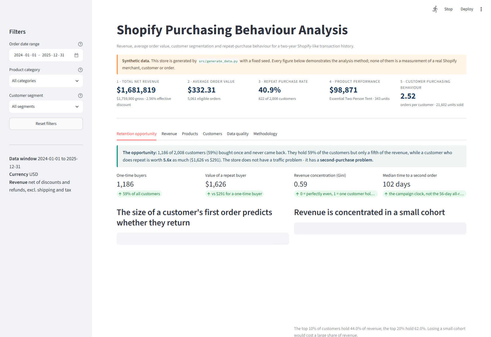

# Shopify purchasing behaviour: finding the retention opportunity

**An end-to-end e-commerce analysis that answers one business question —
*how do we turn one-time buyers into repeat buyers?* — and ends with a
controlled experiment rather than a conclusion.**

Python · SQLite · SQL (CTEs, window functions, ranking) · Streamlit + Plotly ·
40 named queries · 23 data-quality checks · 58 automated tests · 13 figures

> ### ⚠️ The data is synthetic
>
> Shopify publishes no public transaction dataset, and the workspace this
> project was built in contained no e-commerce data. Rather than quietly
> substituting an unrelated public dataset, this project **generates its own
> store** (`src/generate_data.py`, fixed seed `20261025`) and labels every
> finding as a demonstration.
>
> **No number here describes a real Shopify merchant, customer or order**, and
> this project was not commissioned by Shopify. What is real is the method:
> the revenue definition, the cleaning rules, the reconciliation, the
> segmentation, the experiment design and the test suite. All of it applies
> unchanged to a real export.

---

## 1. Executive summary

A two-year synthetic store: **5,061 eligible orders**, **2,008 customers**,
**21,602 units**, **$1,681,819.35 net revenue**, **$332.31 average order value**.

The business question was *where is the retention opportunity?* The answer the
data supports:

| | |
|---|---:|
| Customers who bought exactly once and never returned | **1,186** (59.06% of customers, 20.51% of revenue) |
| Value of a repeat buyer vs a one-time buyer | **$1,626.44 vs $290.80 — 5.6×** |
| Repeat rate by size of the customer's **first** order | **29.37%** (1 unit) → **48.19%** (5+ units) |
| Median time from a first order to a second order | **102 days** |
| Revenue concentration | Gini **0.5853**; the top 10% of customers hold **43.99%** |
| Year-on-year revenue change | **+157.5%** — customers +297.2%, orders per customer **−30.7%**, AOV −6.4% |

**The conclusion:** the store has a second-purchase problem, not a traffic
problem. Growth came entirely from acquiring more customers who buy 1.42 times
each, while the cohort it already had bought *more* (3.30 orders in 2025
versus 2.70 in 2024). The analysis identifies **who** to target and **when** to
contact them — and it explicitly does **not** claim that contacting them will
work. The recommendation is a holdout-tested experiment.

**Full write-up:** [`reports/decision_report.md`](reports/decision_report.md)

---

## 2. Business problem and analytical objective

> **How can an e-commerce business find customer-retention and product-sales
> opportunities using purchasing behaviour — and test the first one properly?**

* **Problem:** the store's revenue is concentrated in a small cohort, and it has
  never tested whether the customers it already has can be persuaded to buy
  again.
* **Objective:** size the retention opportunity, identify which customers are
  at risk using purchasing behaviour alone, establish when to contact them, and
  design an experiment that would prove or disprove the intervention.
* **Scope:** one primary opportunity (retain one-time buyers) and two
  supporting observations. Cross-selling is the *mechanism* of the retention
  test, not a separate project.

---

## 3. Key findings — synthetic demonstration results

1. **A third of the customers produce three quarters of the revenue.** The
   High Value segment is 669 of 2,008 customers and **75.73%** of net revenue;
   the Low Engagement third is 33.37% of customers and **5.41%** of revenue.
2. **Value comes from frequency, not basket size.** The *Regular* segment has
   the **highest** AOV ($368.72 vs High Value's $360.72) but only 1.29 orders
   each, so optimising for "highest AOV segment" would target the group that
   produces 18.85% of revenue.
3. **The first order predicts whether a customer returns** — a 19-point
   spread between a one-item first order (29.37% repeat) and a five-plus-item
   first order (48.19%).
4. **The first repeat is much slower than later repeats** — median 102 days
   against 56. A campaign built on the average fires after the customer has
   already returned.
5. **A quarter of the units earn a seventh of the revenue.** Beauty and
   Kids & Baby are 25.55% of units but 13.48% of revenue ($39.00 and $43.16
   per unit against $101–$109 for Footwear, Electronics and Sports & Outdoors).


---

## 4. The recommendation and how it would be measured

> **Test a second-purchase campaign against one-time buyers, with a holdout
> group. Do not roll it out on the strength of this analysis.**

| | |
|---|---|
| **Target population** | Customers with exactly one eligible order in the 12 months before test start. Priority tier: the 214 one-item first-order buyers. |
| **Treatment** | A second-purchase offer at day 30 and day 60 — the observed clock — that **adds a second item** from categories the customer already bought rather than discounting the first. |
| **Comparison group** | A randomised, stratified **holdout** of the same population receiving nothing. |
| **Primary outcome** | **Repeat purchase rate within 180 days**, treatment vs holdout. |
| **Secondary outcomes** | Incremental net revenue per eligible customer; second-order AOV vs the $290.80 baseline; days to second order vs the 102-day median. |
| **Guardrails** | AOV not below $290.80; net revenue per contacted customer above holdout; refunds not above the 1.87% baseline. |
| **Evaluation period** | 180 days, long enough for the 102-day median gap to resolve. Power stated before launch. |
| **Success KPI** | Incremental repeat rate (treatment − holdout), significant at the pre-registered power, guardrails intact. |

**No revenue uplift and no ROI are claimed.** The dataset has no cost, margin
or acquisition-spend data, so the business case is "an untested lever and an
identified population", not "this will pay". The full experiment design,
including the limitations of the targeting signal itself, is in
[`reports/decision_report.md`](reports/decision_report.md).

---

## 5. The dashboard

```bash
streamlit run dashboard/app.py
```

Six tabs, and the first one is the answer rather than a KPI wall.



| Tab | What it shows |
|---|---|
| **Retention opportunity** | The business answer: the opportunity callout, repeat propensity by first order, the revenue concentration curve, what a repeat buyer is worth, which segments to target, and what one-time buyers bought |
| **Revenue** | Revenue and order volume over time, the gross→net bridge, the growth decomposition, and revenue by category |
| **Products** | Top products by revenue and by units, and the products that dilute the basket |
| **Customers** | Segment distribution (customers vs revenue), the orders-per-customer distribution and the time-between-purchases metrics |
| **Data quality** | All 23 validation checks, the row-count trail and the reconciliation proof |
| **Methodology** | The definitions behind every number |

Filters for date range, product category and customer segment apply to every
chart. Segments are computed once on the full population and are never
re-computed when a filter changes; the repeat rate is recomputed inside the
filtered selection.

---

## 6. Tools and skills demonstrated

| | |
|---|---|
| **SQL** | CTEs, window functions (`NTILE`, `PERCENT_RANK`, `LAG`, `ROW_NUMBER`, cumulative frames), self-joins for basket pairs, revenue concentration with a Gini coefficient, period-over-period decomposition with an arithmetic proof column, parameterised filtering |
| **Python** | pandas, `sqlite3` with a shared query layer, deterministic seeded data generation, matplotlib reporting |
| **Dashboard** | Streamlit 1.66 + Plotly, cached queries, cross-filtering, Plotly charts driven by named SQL |
| **Engineering** | Integer-cent accounting, a logged data-defect registry, build-time reconciliation assertions, 58 pytest regression tests, dashboard-to-SQL KPI parity checks |
| **Data quality** | 23 validation checks with documented handling rules for every defect class |

---

## 7. Architecture and data flow

```
data/raw/*.csv  ──►  sql/01_schema.sql    raw landing tables (no constraints, as an export arrives)
                 ──►  sql/02_staging.sql  cleaning rules R0–R4  ──►  stg_customers, stg_products,
                 │                                                          stg_orders, stg_order_items
                 ──►  sql/03_marts.sql    facts + customer dimension
                 │                             ──►  fact_orders, fact_order_lines, dim_customers
                 │
                 ├──►  sql/04_analysis_queries.sql   29 named analysis queries
                 ├──►  sql/05_data_quality.sql       11 named validation queries
                 │
                 └──►  src/analytics.py  ──►  src/run_queries.py      reports/sql_results.md
                                      ├──►  src/make_quality_report.py  reports/data_quality.md
                                      ├──►  src/make_figures.py        reports/figures/*.png
                                      ├──►  dashboard/app.py           Streamlit + Plotly
                                      └──►  tests/test_analysis.py    58 regression tests
```

`sql/04_analysis_queries.sql` is the **single source of truth** for every KPI.
The report renderer, the dashboard and the test suite all read the same named
queries through `src/analytics.py`, so they cannot drift apart — and a test
asserts that they do not.

---

## 8. SQL and analytical methodology

**Revenue** = `quantity × unit_price × (1 − discount_pct)` per line, minus the
order's refund allocated pro-rata by net line value. **Shipping and tax are not
revenue** — they are collected for third parties and are reported separately.
The bridge closes exactly and is asserted:

| Step | Amount |
|---|---:|
| Gross item revenue | $1,759,900.43 |
| Less line discounts | −$45,116.84 (2.56% of gross) |
| Less refunds allocated | −$32,964.24 (1.87% of gross) |
| **Net revenue** | **$1,681,819.35** |

**Eligible orders** = `completed`, inside the observation window, resolvable to
a known customer, and containing at least one valid line item. Cancelled,
refunded and pending orders stay in the raw and staging layers and are excluded
from every metric.

**Segmentation** = `value_score = 0.65 × spend percentile + 0.35 × order-count
percentile`, banded by `NTILE(3)` over `(value_score, customer_id)`. Percentiles
make it scale-free, the tiebreak makes it deterministic, and `NTILE(3)`
guarantees the three segments are mutually exclusive and jointly exhaustive.
**Recency is deliberately excluded** — in a right-censored window it measures
tenure, not engagement.

**Repeat purchase rate** = customers with **≥ 2 eligible orders** ÷ distinct
eligible customers. `repeat_purchase_summary` and `kpi_summary` are asserted
to produce identical counts.

Full definitions, formulas and the query catalogue:
**[`docs/methodology.md`](docs/methodology.md)**.

---

## 9. Data-quality and financial reconciliation controls

These are the engineering controls that make the numbers trustworthy — and the
reason a reviewer can check them.

| Control | How it works | Result |
|---|---|---|
| **Integer-cent accounting** | Money is computed in whole cents in both the generator and the SQL. Python's `round()` (half-to-even) and SQLite's `ROUND()` (printf-style) disagree on exact ties; a float build produced one-cent gaps on 37 orders. | exact |
| **Logged data defects** | 93 defects are injected on disjoint row pools and recorded in `data/raw/defects.csv`, then loaded into the database as `defect_log`. | 93 logged |
| **23 validation checks** | Duplicates, dangling references, missing/invalid quantities and prices, inconsistent discounts, unreconciled totals, empty orders, status and date validity. | 97 records flagged, each with a documented handling rule |
| **Reconciliation guarantee** | Refund allocations must sum back to the order refund exactly, and every order subtotal variance must match a logged defect. The build **fails** otherwise. | **0 unexplained** |
| **No silent imputation** | Unattributable rows are dropped, never guessed. The staging layer is tested to contain no row that does not exist in the raw layer. | verified |
| **Growth decomposition proof** | Revenue change must equal customers × frequency × AOV. A regression test catches integer-division truncation that broke this once. | implied +157.5% = actual +157.5% |
| **Dashboard ↔ SQL parity** | The dashboard renders the same named queries the report uses; a test asserts the KPI values are equal. | 5 KPIs asserted |
| **Published-claims tests** | Every number in this README and in the decision report is asserted against the live database. | 15 claim tests |

---

## 10. Reproduction

```bash
git clone <this repository>
cd shopify-purchasing-behavior-analysis
python -m venv .venv && .venv/Scripts/activate      # Windows
pip install -r requirements.txt

python src/run_all.py          # generate → build → query → report → figures → tests
streamlit run dashboard/app.py
pytest -q                      # 58 tests
```

`run_all.py` rebuilds everything from the raw CSVs in about three minutes and
finishes by running the test suite. The CSVs are committed and deterministic,
so the analysis can also be reproduced without running the generator.

**Environment:** Python 3.10+ (developed on 3.12.10). SQLite ships with
Python, so there is no database server to install. All paths are relative to
the project root. No credentials or secrets are used anywhere.

Optional, for regenerating the dashboard screenshots in this README:

```bash
pip install playwright && python -m playwright install chromium
python src/capture_screenshots.py
```

---

## 11. Test and verification results

```
$ pytest -q
58 passed in 111.68s
```

| Suite | Covers |
|---|---|
| `TestDatasetVolume` | ≥ 10,000 line items; the pipeline reconciles; no row is invented; every row is labelled synthetic |
| `TestReconciliation` | Refund allocation and order subtotals reconcile exactly; every variance is explained |
| `TestRevenueFormula` | Revenue recomputed from first principles; the bridge closes; shipping and tax excluded |
| `TestAov` | AOV = revenue ÷ eligible orders; eligible-order counts agree across queries |
| `TestRepeatPurchase` | Repeat rate is 0–100% and matches its definition |
| `TestSegmentation` | Three segments; mutually exclusive and jointly exhaustive; reproducible; correctly ordered |
| `TestDashboardParity` | Dashboard KPIs equal the SQL outputs; filters behave; category revenues sum to the total |
| `TestDashboardApplication` | The Streamlit script runs without exceptions; the real server starts and serves the page |
| `TestQueryLibrary` | All 40 named queries execute; the checks find exactly the injected defects |
| `TestPublishedClaims` | Every number quoted in this README and the decision report |

---

## 12. Limitations and next steps

**Limitations.**

- **The data is synthetic.** The findings demonstrate the method; they do not
  generalise to any real store.
- **The targeting signal is partly an artefact.** In this dataset the link
  between first-order basket size and repeat rate is partly *by construction* —
  the generator draws loyalty tier and basket size from the same latent
  variable. It is a candidate hypothesis for a real store, which is exactly
  what the holdout test is for.
- **The window right-censors lifetime value.** The 40.94% repeat rate is a
  floor, not a lifetime rate.
- **No cost, margin, inventory, traffic or ad-spend data.** Revenue stands in
  for value; no LTV:CAC, contribution or ROI claim is possible.
- **Discounts are confounded by construction** and cannot be read as an
  elasticity.

**Next steps, in order of value.**

1. **Re-run the pipeline on a real export.** Everything except
   `src/generate_data.py` is store-agnostic. The first thing to re-read is the
   revenue definition: a real Shopify export has `total_price`,
   `total_discount`, `total_tax` and `total_shipping` semantics that must be
   understood rather than summed blindly.
2. **Run the holdout test** described in the decision report, with power
   stated before launch.
3. **Add margin and acquisition cost** so that "incremental net revenue per
   eligible customer" can become an ROI statement.
4. **Add traffic and sessions** so the funnel and the true repeat denominator
   can be measured.
5. **Extend the window** so a cohort retention curve can replace the
   right-censored single-window rate.

---

## Repository map

```
shopify-purchasing-behavior-analysis/
├── README.md                     ← you are here
├── requirements.txt
├── shopify_analysis.db           ← rebuilt by src/build_db.py (not committed)
├── data/
│   ├── README.md                 ← how the synthetic data is generated
│   ├── dictionary.md             ← column-level dictionary
│   └── raw/                      ← committed, deterministic CSVs + defect log
├── sql/
│   ├── 01_schema.sql             ← raw landing tables
│   ├── 02_staging.sql            ← cleaning rules R0–R4
│   ├── 03_marts.sql              ← facts, customer dimension, segmentation
│   ├── 04_analysis_queries.sql   ← 29 analysis queries
│   └── 05_data_quality.sql       ← 11 validation queries
├── src/
│   ├── config.py                 ← paths, seed, business rules (single source of truth)
│   ├── generate_data.py          ← the synthetic generator + defect log
│   ├── build_db.py               ← CSV → SQLite, with build-time assertions
│   ├── analytics.py              ← shared query layer for report + dashboard + tests
│   ├── run_queries.py            ← renders reports/sql_results.md
│   ├── make_quality_report.py    ← renders reports/data_quality.md
│   ├── make_figures.py           ← renders reports/figures/*.png
│   ├── capture_screenshots.py    ← optional: real dashboard screenshots
│   └── run_all.py                ← the whole pipeline in one command
├── dashboard/app.py              ← Streamlit + Plotly
├── reports/
│   ├── decision_report.md        ← the business decision report
│   ├── data_quality.md           ← generated validation report
│   ├── sql_results.md            ← every query, every table
│   ├── key_metrics.json          ← headline KPIs as JSON
│   ├── figures/                  ← 13 figures
│   └── screenshots/              ← real dashboard screenshots
├── docs/
│   ├── methodology.md            ← definitions, formulas, rules, query catalogue
│   └── implementation_plan.md    ← the plan this project was built from
└── tests/
    ├── test_analysis.py          ← 58 tests
    └── smoke_dashboard.py        ← boots the real Streamlit server
```

---

**Licence:** code MIT. The dataset is synthetic and generated by this
repository — no third-party data is redistributed.
