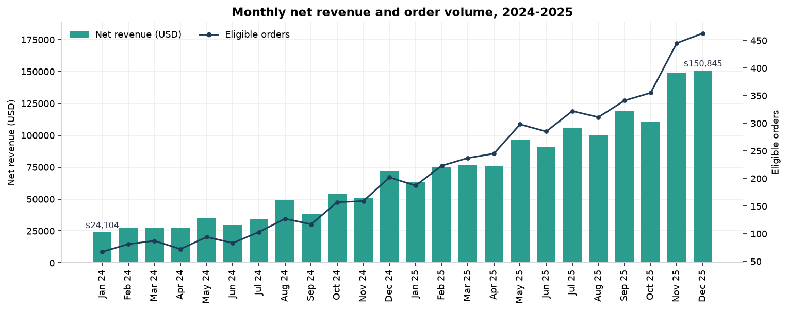
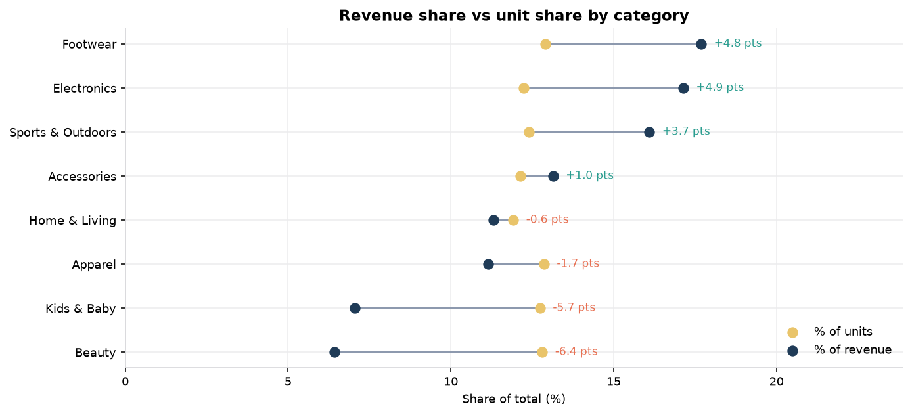
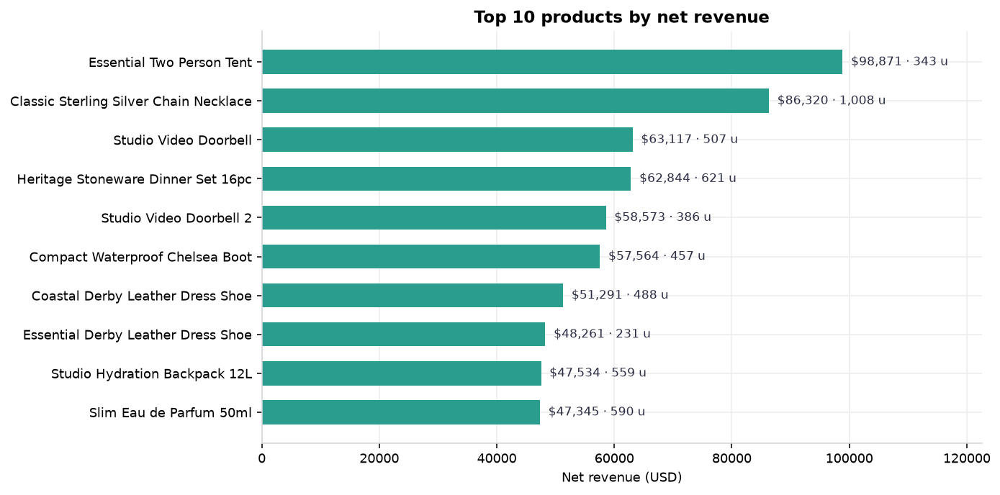
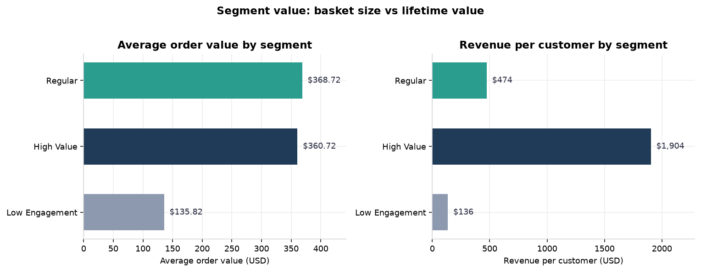

# Shopify purchasing behaviour: what drives revenue, and what to do about it

**Business analysis report** · generated against `shopify_analysis.db` ·
observation window **2024-01-01 → 2025-12-31** · currency **USD**

> ## Read this first
>
> **The dataset is synthetic.** Shopify publishes no public transaction dataset
> and the workspace contained no e-commerce data, so this project generates its
> own store with `src/generate_data.py` (fixed seed `20261025`). Every figure
> below is a **demonstration of the analysis method**. None of them is a
> measurement of a real Shopify merchant, customer or order, and none of them
> should be quoted as a finding about Shopify or about any real customer base.
>
> What *is* real here is the engineering: the revenue definition, the cleaning
> rules, the reconciliation, the segmentation method and the test suite. Those
> transfer unchanged to a real export.

---

## 1. Executive summary

Over 24 months the synthetic store processed **5,061 eligible orders** from
**2,008 customers**, selling **21,602 units** for **$1,681,819.35 of net
revenue**.

| Metric | Value |
|---|---:|
| Gross item revenue | $1,759,900.43 |
| Less line discounts | −$45,116.84 (2.56% of gross) |
| Less refunds | −$32,964.24 (1.87% of gross) |
| **Net revenue** | **$1,681,819.35** |
| Eligible orders | 5,061 |
| Units sold | 21,602 |
| Unique customers | 2,008 |
| Average order value | $332.31 |
| Orders per customer | 2.52 |
| **Repeat purchase rate** | **40.94%** (822 of 2,008 customers) |

**Five things the data says:**

1. **Revenue is extremely concentrated.** The top third of customers (669 of
   2,008) produced **75.73%** of net revenue. The bottom third produced
   **5.41%**. A 14× spread in revenue per customer.

2. **Value comes from frequency, not from bigger baskets.** The *Regular*
   segment has the **highest** AOV of the three ($368.72) — slightly above
   High Value ($360.72) — but High Value customers place **5.28** orders each
   against Regular's **1.29**. Lifetime value per customer is $1,903.91 versus
   $473.99. Chasing a larger basket is chasing the wrong lever.

3. **Repeat buyers are worth 5.6× a one-time buyer.** A repeat customer
   averages 4.71 orders and $1,626.44; a one-time customer has exactly one
   order worth $290.80. **62.97%** of all revenue comes from orders placed after
   a customer's first purchase.

4. **Growth has been volume, and volume is now the only lever.** Revenue grew
   157.4% between 2024 and 2025, but AOV *fell* from $348.76 to $326.33
   (−6.4%). The growth came from 500 → 1,986 buying customers and 1,349 →
   3,712 orders.

5. **A quarter of the units earn a seventh of the revenue.** Beauty and Kids &
   Baby account for **25.55%** of units but only **13.48%** of revenue
   ($39.00 and $43.16 per unit versus $101–$109 for Footwear, Electronics and
   Sports & Outdoors).



---

## 2. Business questions

| # | Question | Where it is answered |
|---|---|---|
| Q1 | Which products and categories generate the most revenue? | §6.1, §6.2 |
| Q2 | How does AOV differ across customer segments? | §6.3 |
| Q3 | Which customer segments purchase most frequently? | §6.3 |
| Q4 | What proportion of customers make repeat purchases? | §6.4 |
| Q5 | What purchasing patterns could improve revenue and retention? | §6.5, §7 |

---

## 3. Dataset and limitations

### 3.1 What the data is

| Entity | Grain | Rows (raw → analysed) |
|---|---|---|
| `customers` | one row per customer | 2,100 → 2,100 |
| `products` | one row per product | 114 → 114 |
| `orders` | one row per order (a checkout event) | 5,360 → 5,061 eligible |
| `order_items` | one row per order line item (a unit of sale) | 15,636 → 14,729 eligible |

The store has 8 categories (Apparel, Footwear, Home & Living, Beauty,
Electronics, Sports & Outdoors, Accessories, Kids & Baby), 114 products,
10 countries, 4 sales channels, 7 payment methods and 7 acquisition channels.

### 3.2 Order vs transaction vs order line item

These three are different things and the project is careful to keep them apart.

| Term | Meaning | Grain in this project | Count |
|---|---|---|---|
| **Order** | One checkout event by one customer. Has a status, a total, a date, a payment method. | `orders.order_id` | 5,360 raw / 5,061 eligible |
| **Transaction** | The event of money actually changing hands. In this project a transaction is an *eligible order*: a completed, paid order with at least one valid line. A cancelled or refunded order was a checkout, not a transaction. | `fact_orders.order_id` | 5,061 |
| **Order line item** | One product, at one price, at one quantity, inside an order. The unit of sale and the grain at which revenue is computed. | `order_items.line_item_id` | 15,636 raw / 14,729 eligible |

A single transaction (order) contains 1–8 order line items; averaging **2.91
line items (4.27 units) per eligible order**. Aggregating revenue at the wrong
grain is the classic error here — for example, counting 5,061 orders as "5,061
products sold" understates volume by more than four times.

### 3.3 Limitations

| Limitation | Consequence |
|---|---|
| The data is synthetic. | No claim here generalises to any real store. Findings demonstrate method, not market behaviour. |
| The window is finite (24 months) and right-censored. | A customer who bought once in month 1 and would have bought again in month 25 is indistinguishable from a genuine one-time buyer. The 40.94% repeat rate is therefore a **floor**, not a lifetime rate. |
| Roughly 6% of customers registered in the final months of the window. | Those customers are mechanically under-qualified for repeat status; including them pulls the repeat rate down. |
| No cost, margin, inventory or advertising-spend data. | No contribution-margin, LTV:CAC or payback analysis is possible. Revenue is a proxy for value, not for profit. |
| No traffic, session, impression or cart data. | Conversion rate, basket-page behaviour and abandonment cannot be measured. |
| Shipping and tax are modelled as a simple country rate. | Tax-inclusive countries (DE/FR/NL/ES) are simplified; the revenue definition excludes tax either way, so revenue is unaffected. |
| Discounts are assigned to lower-tier customers and to Q4 by construction. | The discount/revenue association in §6.5 is **confounded by design** and must not be read as a causal elasticity. |

---

## 4. Data-cleaning decisions

The raw tables are a deliberately dirty landing zone: 93 defects were injected
by the generator and recorded in an audit log (`data/raw/defects.csv`). The
full report is in [`data_quality.md`](data_quality.md). The decisions:

| Decision | Rule | Records affected |
|---|---|---:|
| Drop unattributable lines | A line whose order or product cannot be resolved contributes no money and is removed. Nothing is imputed. | 15 |
| Drop orders with no customer | Revenue cannot be attributed to a customer. | 6 |
| Drop unusable line values | Missing, zero, negative quantity or a missing / non-positive unit price makes revenue uncomputable. | 32 |
| De-duplicate on the Shopify business key | Shopify merges identical product lines inside one cart, so a repeated `(order_id, product_id, quantity, unit_price, discount_pct)` tuple is a repeated export row, not a second sale. Lowest `line_item_id` wins. | 14 |
| Recompute discounts from the percentage | The stored `discount_amount` column is advisory; `discount_pct` is authoritative. | 3 flagged |
| Components beat the stored order total | Where `total ≠ subtotal + shipping + tax`, the components are used and the variance is reported. | 9 |
| Exclude cancelled / refunded / pending orders | They are kept in the raw and staging layers and excluded from every revenue and order-count metric. | 286 raw orders |

**Nothing was imputed, back-filled or silently corrected.** Every dropped row
is either unresolvable or unpriceable, and every reconciliation variance in the
cleaned model is matched to a logged defect (`unexplained = 0`, asserted at
build time and in the test suite).

One subtlety worth stating: the generator injects **12** inconsistent
`discount_amount` values, but the validation query flags only **3**. The other
nine were injected onto lines with a `discount_pct` of zero, where halving the
discount still leaves zero and the two columns genuinely agree. A defect count
that is lower than the number of injected defects is a property of the check,
not evidence of a missed defect — which is why the tests assert the *specific*
count for each check rather than a total.

The check is also scoped to lines with a positive quantity and price. Negative
quantity lines are already invalid under DQ08 and are dropped before they can
carry revenue, and their arithmetic differs between Python's floor-division
and SQLite's truncating division — a difference that never touches the money
model, because every line that can carry revenue has a positive quantity.

**Money is computed in integer cents** in both the generator and the SQL.
Python's `round()` and SQLite's `ROUND()` disagree on exact ties, which
produced one-cent gaps between an order's stored subtotal and its recomputed
lines in an earlier build. Switching to integer cents removed the artefact
rather than tolerating it.

---

## 5. SQL methodology and KPI definitions

### 5.1 The revenue bridge

Every revenue number in this report is the bottom of the same bridge:

```
gross item revenue  = Σ (quantity × unit_price)              $1,759,900.43
less line discounts = −Σ (quantity × unit_price × pct)         −$45,116.84
net item revenue    = gross − discounts                       $1,714,783.59
less refunds        = −Σ order refund (pro-rata to lines)      −$32,964.24
NET REVENUE                                                  $1,681,819.35
```

**Shipping and tax are not revenue.** They are collected on behalf of third
parties and are reported separately. The published `revenue_bridge` query
closes exactly — the test suite asserts it.

Refunds are recorded at order level and allocated to lines **pro-rata by net
line value**, with the rounding remainder assigned to the last line of the
order, so the allocations sum back to the order refund exactly (asserted at
build time).

### 5.2 KPI definitions

| KPI | Definition | Value |
|---|---|---:|
| **Total revenue** | Net revenue (§5.1) over eligible orders | $1,681,819.35 |
| **Eligible orders** | Distinct orders with status `completed`, inside the window, resolving to a known customer, containing ≥ 1 valid line item | 5,061 |
| **Units sold** | Σ quantity over eligible order lines | 21,602 |
| **Average order value** | Net revenue ÷ eligible orders | $332.31 |
| **Unique customers** | Distinct customers with ≥ 1 eligible order | 2,008 |
| **Repeat customers** | Customers with ≥ 2 eligible orders inside the window | 822 |
| **Repeat purchase rate** | Repeat customers ÷ unique customers | 40.94% |
| **Orders per customer** | Eligible orders ÷ unique customers | 2.52 |
| **Revenue per customer** | Net revenue ÷ unique customers | $837.56 |

### 5.3 Segmentation

Three segments, defined by behaviour and reproducible from the data alone:

```
value_score = 0.65 × spend percentile + 0.35 × order-count percentile
segment     = NTILE(3) over (value_score, customer_id)
```

Percentiles make the method scale-free; the `customer_id` tiebreak makes the
banding deterministic for tied scores; `NTILE(3)` guarantees the segments are
mutually exclusive and jointly cover every eligible customer. The weights are
documented rather than tuned: monetary value drives 65% of the score,
engagement 35%.

**Recency is deliberately excluded.** In a right-censored window a recent
registrant has simply had less time to buy, so scoring recency would conflate
tenure with engagement and mislabel new customers as inactive. Recency is
still reported per customer.

| Segment | Customers | Net revenue | % of revenue | Orders each | Revenue each | Score range |
|---|---:|---:|---:|---:|---:|---|
| High Value | 669 | $1,273,716.51 | 75.73% | 5.28 | $1,903.91 | 0.6204 – 0.9976 |
| Regular | 669 | $317,101.99 | 18.85% | 1.29 | $473.99 | 0.2254 – 0.6198 |
| Low Engagement | 670 | $91,000.85 | 5.41% | 1.00 | $135.82 | 0.0000 – 0.2251 |

---

## 6. Findings

### 6.1 Which products and categories generate the most revenue?

**Categories.** Footwear leads at $297,494.12 (17.69%), with Electronics at
$288,292.65 (17.14%) and Sports & Outdoors at $270,709.16 (16.10%). The top
three are 50.93% of revenue on 37.53% of units.


**The revenue-per-unit spread is the interesting part.** Category revenue share
and unit share diverge sharply:

| Category | % of revenue | % of units | Gap | Revenue / unit |
|---|---:|---:|---:|---:|
| Electronics | 17.14% | 12.24% | **+4.90 pts** | $109.04 |
| Footwear | 17.69% | 12.90% | **+4.79 pts** | $106.74 |
| Sports & Outdoors | 16.10% | 12.39% | +3.71 pts | $101.16 |
| Accessories | 13.14% | 12.14% | +1.00 pts | $84.30 |
| Home & Living | 11.30% | 11.92% | −0.62 pts | $73.80 |
| Apparel | 11.15% | 12.86% | −1.71 pts | $67.51 |
| Kids & Baby | 7.06% | 12.74% | **−5.68 pts** | $43.16 |
| Beauty | 6.42% | 12.81% | **−6.40 pts** | $39.00 |



Beauty and Kids & Baby together are **25.55% of units and 13.48% of revenue**.
They are bought constantly and are worth very little each.

**Products.** The best single product is *Essential Two Person Tent* at
$98,870.65 (5.88% of revenue, $288.25 per unit). *Classic Sterling Silver
Chain Necklace* is second by revenue ($86,320.01) and first by volume (1,008
units).



**Product concentration is low.** The top 10 products together are 36.97% of
revenue and the single best product is under 6%. No single product is a
single point of failure — but the same is true of the *dilutive* products:

| Product | Units | % of units | % of revenue | Revenue / unit | Gap |
|---|---:|---:|---:|---:|---:|
| Coastal Daily Hydrating Serum | 839 | 3.88% | 1.75% | $35.04 | −2.14 pts |
| Classic Cast Iron Skillet 26cm | 654 | 3.03% | 2.00% | $51.54 | −1.02 pts |
| Studio Organic Cotton Baby Bodysuit 3-Pack | 438 | 2.03% | 0.93% | $35.64 | −1.10 pts |
| Compact Soft Activity Cube | 384 | 1.78% | 0.58% | $25.18 | −1.20 pts |
| Classic Resistance Band Set | 383 | 1.77% | 0.52% | $22.96 | −1.25 pts |

Four of the five worst are Beauty or Kids & Baby.


### 6.2 How does revenue trend over time?

Revenue grew **157.4%** year on year and the seasonal shape is stable and
strong:

| Quarter | Net revenue | vs previous quarter |
|---|---:|---:|
| 2024 Q1 | $79,499.76 | — |
| 2024 Q2 | $91,825.78 | +15.5% |
| 2024 Q3 | $122,311.95 | +33.2% |
| 2024 Q4 | $176,844.01 | +44.6% |
| 2025 Q1 | $214,346.49 | +21.2% |
| 2025 Q2 | $262,789.27 | +22.6% |
| 2025 Q3 | $324,308.45 | +23.4% |
| 2025 Q4 | $409,893.64 | +26.4% |

Q4 carried 37.59% of 2024 revenue and 33.84% of 2025 revenue. December is the
peak month in both years ($71,599.39 and $150,845.28).

**The important decomposition:** revenue grew 157.4% while **AOV fell 6.4%**
($348.76 → $326.33). Every dollar of growth came from more customers
(500 → 1,986) and more orders (1,349 → 3,712), not from larger baskets.

### 6.3 How does AOV differ across segments, and who buys most often?

| Segment | Orders | Customers | AOV | Orders / customer | Units / order | Revenue / customer | % of revenue |
|---|---:|---:|---:|---:|---:|---:|---:|
| Regular | 860 | 669 | **$368.72** | 1.29 | 4.51 | $473.99 | 18.85% |
| High Value | 3,531 | 669 | $360.72 | **5.28** | **4.57** | **$1,903.91** | **75.73%** |
| Low Engagement | 670 | 670 | $135.82 | 1.00 | 2.37 | $135.82 | 5.41% |



**The headline AOV ranking is a trap.** Regular customers spend the most per
order — $368.72, above High Value's $360.72. If the business optimises for
"highest AOV segment", it targets the group that generates 18.85% of revenue.
High Value customers win on **frequency** (5.28 orders against 1.29) and on
total value (14.0× a Low Engagement customer).

The Regular segment is the interesting one: it has the best basket economics in
the store and almost none of the frequency.


### 6.4 What proportion of customers make repeat purchases?

**40.94%** — 822 of 2,008 customers placed at least two eligible orders.

| Orders placed | Customers | % of customers |
|---:|---:|---:|
| 1 | 1,186 | 59.06% |
| 2 | 221 | 11.01% |
| 3 | 188 | 9.36% |
| 4 | 178 | 8.86% |
| 5+ | 235 | 11.71% |
| **Total** | **2,008** | **100%** |

| Customer type | Customers | Orders each | Revenue each | AOV | Units | Categories |
|---|---:|---:|---:|---:|---:|---:|
| Repeat | 822 | 4.71 | **$1,626.44** | $335.76 | 20.90 | 5.01 |
| One-time | 1,186 | 1.00 | $290.80 | $290.80 | 3.73 | 2.09 |

A repeat customer is worth **5.6×** a one-time customer. **62.97%** of all
revenue comes from repeat orders, and that share is entirely concentrated:
81.13% of High Value revenue is repeat revenue, 15.25% of Regular's, and 0%
of Low Engagement's (by definition — every Low Engagement customer has exactly
one order).


**Time between purchases.** Across 3,053 measured intervals:

| Statistic | Days |
|---|---:|
| Median | **56** |
| Mean | 87.6 |
| Minimum | 1 |
| Maximum | 672 |

32.98% of repeats happen within 30 days and 65.05% within 90 days. The mean
sits far above the median because of a long dormant tail — customers who come
back after six months or more.


**The second purchase is slower than a later repeat — and the two must not be
averaged together.** The 56-day median above pools *every* gap between
consecutive orders. Measured over only the 822 first→second transitions, the
median is **102 days** (mean 134), and just 21.05% of second orders land within
30 days, 37.83% within 60 days and 46.84% within 90 days. A customer who comes
back once buys again far faster after that. **The campaign clock for a first
repeat is 102 days, not 56** — a second-purchase programme triggered on the
all-repeat average would arrive after two thirds of the eligible customers had
already converted.


### 6.5 What purchasing patterns could improve revenue and retention?

**a) The Regular segment has the store's best basket economics and none of its
frequency.** 669 customers, AOV $368.72 (the highest of the three), but only
1.29 orders each and 15.25% repeat revenue.

**b) Units per order tracks customer value almost perfectly.** High Value
4.57 units per order, Regular 4.51, Low Engagement 2.37. Every segment that
buys more items per order is worth more — and the two low-value categories
(Beauty $39.00/unit, Kids & Baby $43.16/unit) are the ones that most often
fill the basket cheaply.

**c) Discounts concentrate in lower-value baskets — but this is confounded.**
Orders touching no discount average $282.49 of revenue; orders touching the
1–10% band average $125.40; the 21–25% band, $88.08. **This cannot be read as
a discount elasticity.** In this dataset discounts are applied preferentially
to one-time and lower-tier customers and are more likely in Q4, so customer
selection and seasonality are confounded with the discount itself. A real
store would need a randomised or quasi-experimental design to separate them.

**d) Mobile is the strongest channel per order.** mobile_app $343.90 AOV vs
online $330.09, pos $320.26, marketplace $319.84. Online still carries 60.47%
of revenue.

**e) Acquisition channel barely moves value.** Repeat rates run 37.38%
(referral) to 43.54% (affiliate); social_organic has the highest AOV ($368.61)
but only 142 customers. Channel choice is not where the money is.

**f) Revenue is concentrated in a cohort the business has never tested.** The
Gini coefficient of customer revenue is **0.5853**. The top 1% of customers
hold 8.97% of revenue, the top 10% hold **43.99%**, the top 20% hold
**62.03%**, and the top half hold 88.13% — so the bottom half of the customer
base produces 11.87% of revenue. Losing a small cohort would cost a large
share of the business, which makes retention a revenue-protection problem and
not merely a nice-to-have.


**g) The size of a customer's *first* order predicts whether they come back.**
Repeat rate rises monotonically with first-order basket size:

| First order | Customers | Repeat rate | Never returned | Avg lifetime revenue |
|---|---:|---:|---:|---:|
| 1 unit | 303 | **29.37%** | 214 | $408.02 |
| 2 units | 334 | 38.32% | 206 | $637.08 |
| 3–4 units | 651 | 39.63% | 393 | $762.82 |
| 5+ units | 720 | **48.19%** | 373 | $1,178.90 |

The 303 customers whose first order was a single item are the most
at-risk population in the store: fewer than three in ten of them returned, and
214 never did. **This signal is partly an artefact of this dataset** — the
generator draws loyalty tier and basket size from the same latent variable —
so it is a candidate hypothesis for a real store, not a finding about one. It
is precisely the kind of signal that needs a holdout test rather than a
rollout.


**h) Growth is acquisition, not retention — and the existing cohort bought
more.** Revenue grew **+157.5%** year on year. The decomposition closes
exactly: customers **+297.2%** × orders per customer **−30.7%** × AOV **−6.4%**
= +157.5%. The blended fall in orders per customer is a **cohort-mix effect,
not deteriorating customers**: the 2025 acquisition cohort bought 1.42 orders
each (1,508 customers), while the customers carried over from 2024 bought
**3.30** each (478 customers). The store added a large, shallow cohort; the
cohort it already had bought more, not less.


---

## 7. Recommendations

Each recommendation names the finding behind it and the business action it
supports. No revenue uplift is claimed — these are tests to run, with the
metric to measure.

### Recommendation 1 — Treat purchase frequency, not basket size, as the primary growth lever

**Finding.** High Value customers generate 75.73% of revenue on 5.28 orders
each, while 81.13% of their revenue comes from repeat orders. Regular
customers have the store's highest AOV ($368.72) but place only 1.29 orders
and produce just 15.25% repeat revenue. The 669-customer Regular segment
contributes $317,101.99 in total.

**Action.** Run a second-purchase programme aimed at the Regular segment —
specifically at the **516 Regular customers with exactly one order** (669 − 153
who have already repeated). Those 516 are worth $492.03 each on that single
order and buy across 2.70 categories, so the second order should be a repeat
of something they have already chosen, not a cross-sell into an unfamiliar
category. Add a spend threshold above the $75 free-shipping threshold, since
shipping is currently charged on the smaller baskets.

**Measure.** Repeat purchase rate in the Regular segment (currently 22.87%),
and second-order revenue per contacted customer. Hold out a control group — the
difference between the whole business and one segment is a selection effect, and
only a holdout isolates the campaign's effect.

### Recommendation 2 — Rebalance the basket around revenue per unit

**Finding.** Beauty and Kids & Baby are 25.55% of units but 13.48% of
revenue. The two worst individual offenders — *Coastal Daily Hydrating Serum*
(3.88% of units, 1.75% of revenue) and *Studio Organic Cotton Baby Bodysuit
3-Pack* (2.03% of units, 0.93% of revenue) — sit inside them. Meanwhile
Electronics, Footwear and Sports & Outdoors earn $101–$109 per unit against
$39.00 and $43.16 for the two weak categories. High Value customers buy 4.57
units per order; Low Engagement customers buy 2.37.

**Action.** Two concrete changes: (1) build a bundle or add-on ladder that
pairs the high-volume low-value products with a higher revenue-per-unit
product — the two categories most often bought together are Apparel + Beauty
(396 baskets) and Beauty + Kids & Baby (375); (2) test a free-shipping
threshold that sits above the current basket sizes of the Low Engagement
segment, since that segment buys 2.37 units per order at $135.82 per customer
and is the group most likely to be shipping-suppressed.

**Measure.** Revenue per unit by category and units per order, both before and
after. Watch for the obvious failure mode: raising the threshold pushes
customers out of the threshold rather than into a bigger basket.

### Recommendation 3 — Trigger lifecycle campaigns on the observed repeat clock, not on the mean

**Finding.** The median gap between orders is 56 days but the mean is 87.6 and
the maximum is 672. A campaign timed on the mean fires far too late for the
buyers who return quickly. 32.98% of repeats occur within 30 days and 65.05%
within 90 days, so the repeat mass is concentrated but the tail is long. The
**first** transition is slower than the rest: the 822 first→second gaps have a
median of **102 days**, and only 21.05% of second orders land within 30 days.

**Action.** Run three distinct flows instead of one. A **nurture flow** at 30
days catches the third of repeats that happen inside a month; a **win-back
flow** at 90 days catches the 65% mark and treats the remainder as a separate,
lower-probability reactivation. Segment both flows by the customer's own
segment, because the High Value segment's repeat revenue is 81.13% of its
total while Regular's is 15.25% — the same message will not perform for both.
For the **one-time-buyer** audience, which is where the opportunity actually
sits, the clock is the 102-day first→second median, so the first contact
should land at **day 30** and a second at **day 60** — deliberately ahead of
the median, because the median is where the customer converts without help.

**Measure.** Incremental repeat orders per contacted customer against a
holdout, and the median gap for the treated cohort versus the control. Report
on the median, not the mean, because the mean is dragged by exactly the tail
this flow is trying to reach. The full experiment design for this
recommendation — target population, treatment, holdout construction, primary
and secondary outcomes, guardrails and evaluation window — is in
**[`reports/decision_report.md`](decision_report.md)**.

---

## 8. Limitations and next steps

**Limitations.** The dataset is synthetic, so these findings demonstrate the
method and cannot be generalised. The 24-month window right-censors lifetime
value, so the 40.94% repeat rate is a floor. There is no cost, margin,
inventory, traffic or advertising-spend data, so revenue stands in for value
throughout. The discount analysis in §6.5 is confounded by construction.

**Next steps, in order of value:**

1. **Re-run this pipeline against a real export.** Everything except
   `src/generate_data.py` is store-agnostic: drop the CSV files in
   `data/raw/`, adjust the column names in `src/build_db.py`, and the schema,
   cleaning rules, queries, dashboard and tests apply unchanged. The first
   thing to re-examine is the revenue definition, because a real Shopify export
   has `total_price`, `total_discount`, `total_tax` and `total_shipping`
   semantics that must be read carefully rather than summed blindly.
2. **Add margin.** `cost` per product would convert revenue-weighted findings
   into contribution-weighted ones, and would likely change the category
   ranking in §6.1 — Beauty at $39.00/unit may be perfectly profitable.
3. **Add acquisition cost.** `acquisition_channel` without spend cannot
   produce a CAC or a LTV:CAC ratio, so channel spend cannot be judged.
4. **Add traffic and sessions** to convert order counts into conversion rates
   and to make the repeat-rate denominator the right one.
5. **Build a cohort table by registration month.** With a longer window and a
   stable acquisition mix, a cohort retention curve would show whether the
   40.94% repeat rate is structural or an artefact of the window, and would
   make the two lifecycle flows in Recommendation 3 measurable.
6. **Instrument the campaigns** in Recommendations 1–3 with holdout groups
   *before* launch, so that the effect is attributable rather than inferred.

---

## Appendix — where every number comes from

| Artefact | Contents |
|---|---|
| [`sql_results.md`](sql_results.md) | Output of all 33 named queries, including every table in this report |
| [`data_quality.md`](data_quality.md) | The 23 validation checks, the row-count trail and the defect log |
| [`key_metrics.json`](key_metrics.json) | The headline KPIs as machine-readable JSON |
| [`figures/`](figures/) | The 10 figures referenced above |
| [`../docs/methodology.md`](../docs/methodology.md) | Full definitions, formulas and rules |
| [`../data/dictionary.md`](../data/dictionary.md) | Column-level dictionary for all four tables |
