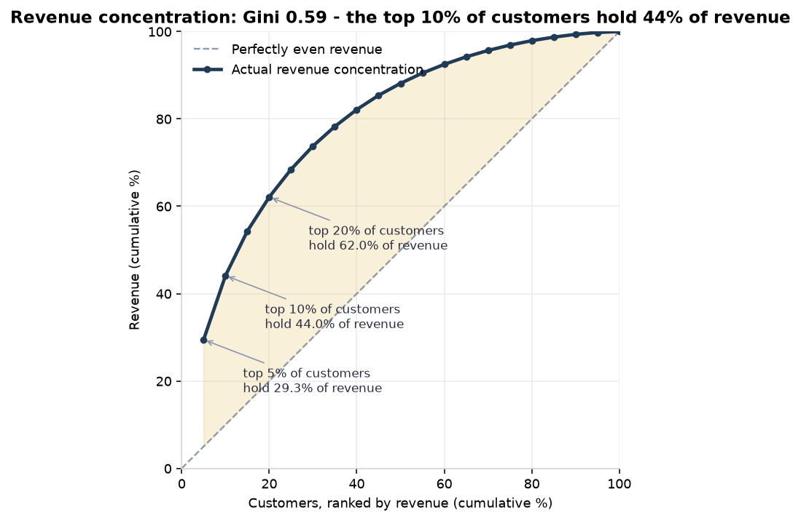
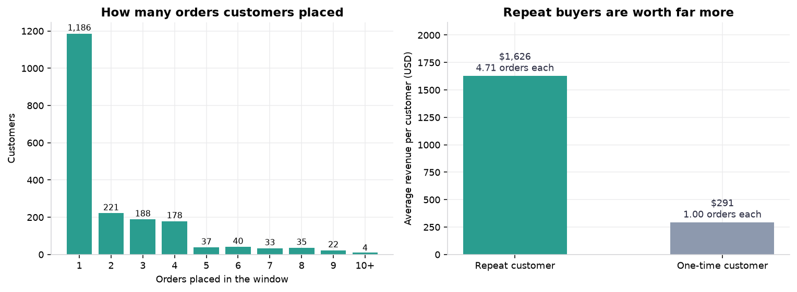
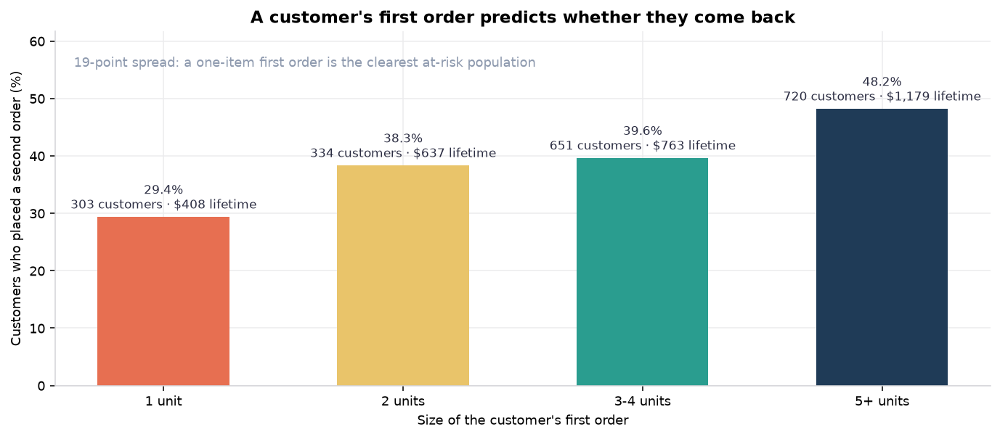
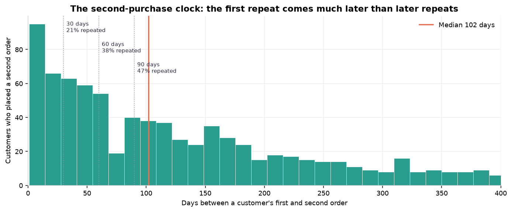
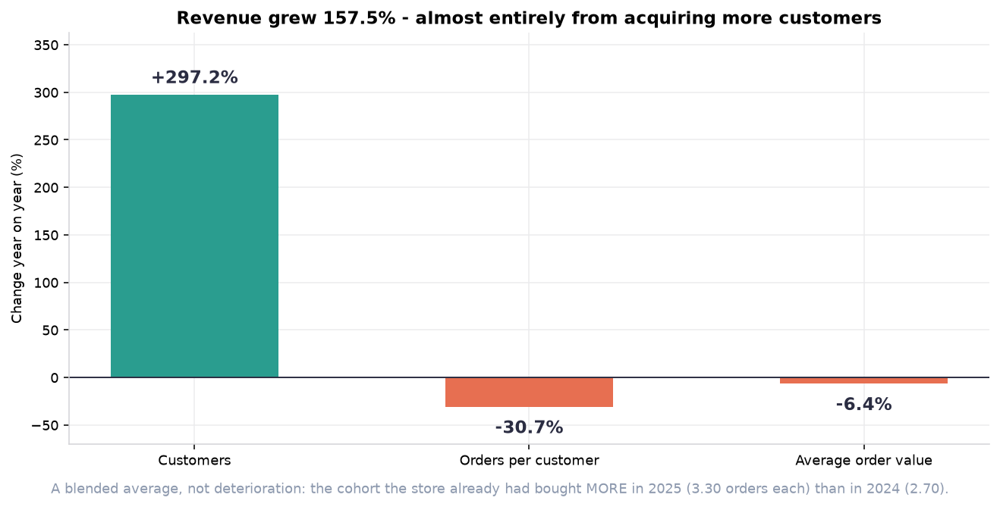
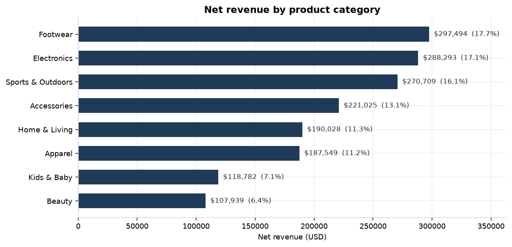
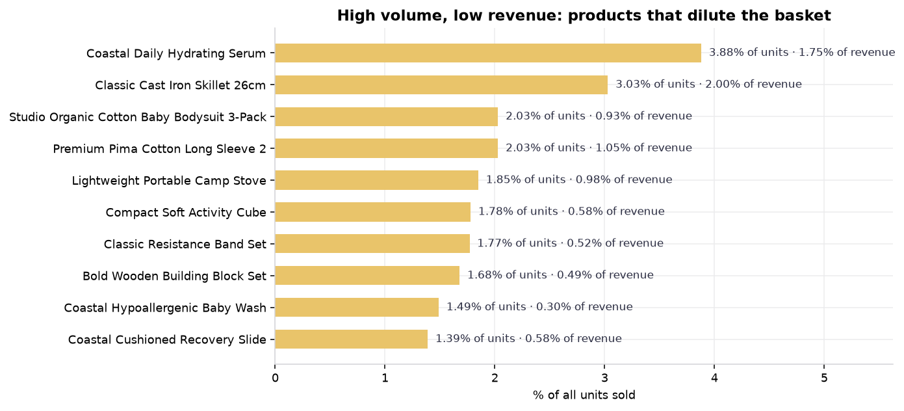

# Decision report: converting one-time buyers into repeat buyers

**Shopify purchasing behaviour analysis** · synthetic demonstration dataset ·
observation window **2024-01-01 → 2025-12-31** · currency **USD**

> ### Read this first
>
> **The dataset is synthetic.** Shopify publishes no public transaction dataset
> and the workspace this project was built in contained no e-commerce data, so
> the store is generated by `src/generate_data.py` (fixed seed `20261025`).
> Every number below demonstrates the analysis method. None of it is a
> measurement of a real Shopify merchant, customer or order, and none of it may
> be quoted as Shopify performance.
>
> What transfers to a real store is the method: the revenue definition, the
> cleaning rules, the reconciliation, the segmentation and the test suite.

---

## 1. Business problem

> **How can an e-commerce business find customer-retention and product-sales
> opportunities using purchasing behaviour — and test the first one properly?**

The store is growing fast, but the growth is entirely explained by buying more
customers. The business has never tested whether the customers it already has
can be persuaded to buy again. That is the question this project answers.

**Scope of the decision:** one primary opportunity (retain one-time buyers),
with two supporting observations that make it urgent. Cross-selling is treated
as the *mechanism* of the retention test, not as a separate project.

---

## 2. Key findings

### Finding 1 — Revenue is concentrated in a cohort the business has never tested

| | |
|---|---:|
| Gini coefficient of customer revenue | **0.5853** |
| Revenue held by the top 10% of customers | **43.99%** |
| Revenue held by the top 20% of customers | **62.03%** |
| Revenue held by the top 50% of customers | 88.13% |

A Gini of 0.59 is substantial inequality. Half of the customers produce 12% of
revenue; the top fifth produce 62%.

### Finding 2 — The store has a second-purchase problem, not a traffic problem

| | Customers | Net revenue | Revenue per customer | Orders each |
|---|---:|---:|---:|---:|
| One-time buyers | **1,186** (59.06%) | $344,888.56 (20.51%) | $290.80 | 1.00 |
| Repeat buyers | 822 (40.94%) | $1,336,930.79 (79.49%) | $1,626.44 | 4.71 |

A repeat buyer is worth **5.6×** a one-time buyer. Nearly three in five
customers bought exactly once.

### Finding 3 — The size of a customer's first order identifies who is at risk

| First order | Customers | Repeat rate | Never repeated | Lifetime revenue |
|---|---:|---:|---:|---:|
| 1 unit | 303 | **29.37%** | 214 | $408.02 |
| 2 units | 334 | 38.32% | 206 | $637.08 |
| 3–4 units | 651 | 39.63% | 393 | $762.82 |
| 5+ units | 720 | **48.19%** | 373 | $1,178.90 |

A **19-point spread**. A customer whose first order contained one item repeats
at 29.37%; one whose first order contained five or more repeats at 48.19%.
The 214 one-item buyers are the clearest at-risk population in the store.

### Finding 4 — The second purchase comes later than a later repeat

| | First → second order | All repeats |
|---|---:|---:|
| Median gap | **102 days** | 56 days |
| Mean gap | 134 days | 88 days |
| Repeated within 30 days | 21.05% | 32.98% |
| Repeated within 60 days | 37.83% | 52.87% |
| Repeated within 90 days | 46.84% | 65.05% |

This is the number that matters for campaign timing. A "send a reminder at 30
days" rule built on the all-repeat average would be calibrated to the wrong
clock — the first repeat is nearly twice as slow as a later one.

### Finding 5 — Growth is acquisition, not retention

| Factor | 2024 | 2025 | Change |
|---|---:|---:|---:|
| Customers | 500 | 1,986 | **+297.2%** |
| Orders per customer | 2.698 | 1.869 | **−30.7%** |
| Average order value | $348.76 | $326.33 | **−6.4%** |
| **Net revenue** | **$470,481.50** | **$1,211,337.85** | **+157.5%** |

The three factors reproduce the total: 3.972 × 0.693 × 0.936 − 1 = +157.5%,
matching the observed change exactly. The query carries that arithmetic as a
proof column and a test asserts it.

**The 30.7% fall in orders per customer is a cohort-mix effect, not
deterioration.** Splitting 2025 orders by customer tenure settles it:

| Year | Order type | Customers | Orders | Orders per customer |
|---|---|---:|---:|---:|
| 2024 | Acquisition year | 500 | 1,349 | 2.698 |
| 2025 | Acquisition year | 1,508 | 2,135 | 1.416 |
| 2025 | Existing customer | 478 | 1,577 | **3.299** |

The 478 customers carried over from 2024 bought **more** in 2025 (3.30 orders)
than they did in 2024 (2.70). The blended average fell because a much larger
cohort of mostly one-time buyers arrived. The retained cohort is not the
problem — **acquisition quality is**.

### Finding 6 — Where the revenue comes from

| Category | % of revenue | % of units | Revenue per unit |
|---|---:|---:|---:|
| Footwear | 17.69% | 12.90% | $106.74 |
| Electronics | 17.14% | 12.24% | $109.04 |
| Sports & Outdoors | 16.10% | 12.39% | $101.16 |
| Accessories | 13.14% | 12.14% | $84.30 |
| Home & Living | 11.30% | 11.92% | $73.80 |
| Apparel | 11.15% | 12.86% | $67.51 |
| Kids & Baby | 7.06% | 12.74% | $43.16 |
| Beauty | 6.42% | 12.81% | $39.00 |

Product revenue is not concentrated: the best product is *Essential Two Person
Tent* at $98,870.65 (5.88%) and the top 10 products are 36.97% of revenue. The
strongest pattern is price mix — Beauty and Kids & Baby are **25.55% of units
but 13.48% of revenue**.

One-time buyers already buy across every category at a value close to the
category average (Beauty $70.71 AOV, Electronics $197.41), so a second-order
offer can be built from what they have already chosen rather than from
cross-sell into something unfamiliar.

---

## 3. Recommendation

> ### Test a second-purchase campaign against one-time buyers, with a holdout
> ### group. Do not roll it out on the strength of this analysis.

The analysis identifies **who** to target and **when** to contact them. It does
**not** prove that contacting them changes their behaviour — only a controlled
experiment can show that. The recommendation is therefore to run one.

### 3.1 Observed finding

1,186 customers (59.06%) bought exactly once and never returned, contributing
20.51% of net revenue ($344,888.56). A customer who repeats is worth 5.6× as
much. Revenue is concentrated (Gini 0.5853; the top 10% of customers hold
43.99%), so the store's revenue base is narrower than its customer list
suggests. Meanwhile growth is coming only from acquisition: customers +297.2%
year on year, orders per customer −30.7%, AOV −6.4%.

### 3.2 Supporting evidence

| Evidence | Query | Value |
|---|---|---|
| Repeat buyers are worth 5.6× one-time buyers | `repeat_vs_single_customer_profile` | $1,626.44 vs $290.80 |
| One-time buyers are 59.06% of customers, 20.51% of revenue | `repeat_purchase_summary` | 1,186 customers |
| First-order basket size identifies the at-risk group | `repeat_propensity_by_first_order` | 29.37% vs 48.19% repeat rate |
| The second purchase comes later than later repeats | `first_repeat_gap` | median 102 days |
| Revenue is concentrated | `revenue_concentration` | Gini 0.5853 |
| Growth came from acquisition, not retention | `revenue_growth_decomposition` | +297.2% customers, −30.7% frequency |
| Existing customers bought more, not less | `orders_by_customer_tenure` | 3.299 vs 2.698 orders |

### 3.3 Business implication

The store has a proven retention mechanic it is not using. It is paying to
acquire 1,508 new customers a year who buy 1.42 times each, and it already has
1,186 warm leads who bought once and left. If even part of that pool converts,
it is cheaper than acquisition — **but this dataset has no cost, margin or
acquisition-spend data, so no cost comparison or ROI can be claimed here.** The
business case is that the store has an untested lever and an identified,
reachable population, not that a campaign is guaranteed to pay.

### 3.4 Proposed action

A single controlled test, in three parts:

| Element | Definition |
|---|---|
| **Target population** | Customers with exactly one eligible order, who bought in the 12 months before the test start, excluding anyone contacted in the previous 90 days. Priority tier: the 214 one-item first-order buyers (29.37% repeat rate, $81.02 AOV) — the group the analysis flags as at risk. Secondary tier: the remaining one-time buyers. |
| **Treatment** | A second-purchase offer timed to the observed clock: a first touch at day 30 (catches the 21.05% who return by then) and a second at day 60 (37.83% cumulative). The offer should **add a second item** from the categories the customer already bought rather than discount the first — that is the behaviour the propensity analysis identifies (Finding 3), and a bundle keeps the basket above the $75 free-shipping threshold that the $81.02 one-item basket only just clears. Discounting the first order would instead cost margin on a segment the store already knows is the least profitable. |
| **Comparison group** | A randomly selected **holdout** of eligible one-time buyers who receive nothing, drawn from the same population and stratified on first-order basket size and acquisition quarter. Without a holdout, any measured difference cannot be separated from seasonality or from the natural drift the data already shows. |
| **Primary outcome** | **Repeat purchase rate within 180 days** of the customer's first order — treatment vs holdout, on the eligible one-time-buyer population. |
| **Secondary outcomes** | Incremental net revenue per eligible customer; second-order AOV versus the $290.80 one-time baseline; days to second order versus the 102-day median. |
| **Guardrails** | Average order value must not fall below the $290.80 one-time baseline; net revenue per contacted customer must exceed holdout net revenue per contacted customer (this is the profitability proxy available without cost data); no increase in refunds above the 1.87% baseline; no cannibalisation measured as net revenue per eligible customer falling below holdout. |
| **Evaluation period** | 180 days from test start, matching the primary outcome window and long enough for the median 102-day gap to resolve. Power the test on the 29.37% baseline rate before launch — at 1,186 eligible customers split across treatment and holdout, the detectable difference must be stated in advance. |
| **Stop rule** | If the treatment group's repeat rate is not statistically distinguishable from holdout at 90 days, stop and re-test a different offer rather than extending the spend. |

### 3.5 Success KPI

**Incremental repeat purchase rate**: (repeat rate in treatment − repeat rate in
holdout) over the same 180-day window on the eligible one-time-buyer
population. The business should proceed to a rollout decision only if this
difference is positive, significant at the pre-registered power, and the
guardrails hold.

**No revenue uplift is claimed in advance.** The size of the prize is described,
not forecast: 1,186 customers are reachable, and a repeat buyer is worth 5.6×
a one-time buyer.

### 3.6 Limitations of the recommendation

- **The mechanism is not proven.** In this synthetic dataset the link between
  first-order basket size and repeat rate is partly **by construction** — the
  generator draws loyalty tier and basket size from the same latent variable,
  so the association is real *within the data* but is a selection artefact, not
  a causal mechanism. On a real store it is a **candidate hypothesis** to
  validate, which is exactly what the holdout test is for.
- **No profitability claim is possible.** The dataset has no cost, margin,
  inventory or acquisition-spend data. Revenue stands in for value. To claim
  ROI the business needs product cost, gross margin and cost per acquisition.
- **The window right-censors lifetime value.** The 40.94% repeat rate is a
  floor, not a lifetime rate; customers who registered late had less time to
  repeat.
- **Discounts are confounded by design.** Discounted baskets look weaker in
  this data, but discounts were assigned preferentially to lower-tier customers
  and in Q4, so no elasticity can be read from it.
- **Generalisation is unproven.** One store, one synthetic dataset, one
  24-month window.

---

## 4. Secondary observations

These support the recommendation but are **not** separate projects.

**4.1 The campaign clock is the first → second gap, not the average repeat
gap.** 102 days, not 56. A lifecycle programme built on the average will fire
after the majority of the population has already come back.

**4.2 The store has no product concentration risk, but it does have a price-mix
problem.** The top 10 products are only 36.97% of revenue, so no single SKU is
a point of failure. But Beauty and Kids & Baby are 25.55% of units and 13.48%
of revenue, and four of the five worst revenue-per-unit products sit in them.
This is a merchandising observation to carry into the campaign design, not a
separate recommendation.

---

## 5. What was checked before trusting any of this

| Control | Result |
|---|---|
| Revenue bridge closes | gross $1,759,900.43 → discounts −$45,116.84 → refunds −$32,964.24 → net $1,681,819.35 |
| Shipping and tax excluded from revenue | confirmed; reported separately |
| Every eligible order is `completed`, in-window, customer-resolved, with a valid line | 5,061 of 5,360 raw orders |
| Refund allocation sums back to the order refund | exact, for every order, in integer cents |
| Stored order subtotals reconcile with their line items | every variance explained by a logged defect; **0 unexplained** |
| 23 data-quality checks on the raw layer | 97 records flagged, all handled by a documented rule |
| Growth decomposition reproduces the revenue change | implied +157.5% vs actual +157.5% |
| Dashboard KPIs equal the analytical SQL | asserted in `TestDashboardParity` |
| Every number in this report | asserted against the database in `TestPublishedClaims` |

Full detail: [`data_quality.md`](data_quality.md) · [`sql_results.md`](sql_results.md) ·
[`methodology.md`](../docs/methodology.md).

---

## 6. Figure index

| Figure | Business question it answers |
|---|---|
| `01_revenue_trend.png` | How did revenue and order volume move over the window? |
| `02_revenue_growth_decomposition.png` | What explains the change in revenue? |
| `03_revenue_by_category.png` | Which categories generate revenue? |
| `04_top_products.png` | Which products generate revenue? |
| `05_segment_value.png` | How do AOV and lifetime value differ by segment? |
| `06_segment_distribution.png` | How do customers and revenue split by segment? |
| `07_repeat_propensity_by_first_order.png` | Who is at risk of never repeating? |
| `08_repeat_behaviour.png` | What is a repeat buyer worth? |
| `09_first_repeat_gap.png` | When do customers come back? |
| `10_revenue_bridge.png` | What exactly counts as revenue? |
| `11_revenue_concentration.png` | How concentrated is customer revenue? |
| `12_revenue_vs_unit_share.png` | Which categories dilute the basket? |
| `13_dilutive_products.png` | Which specific products dilute the basket? |
